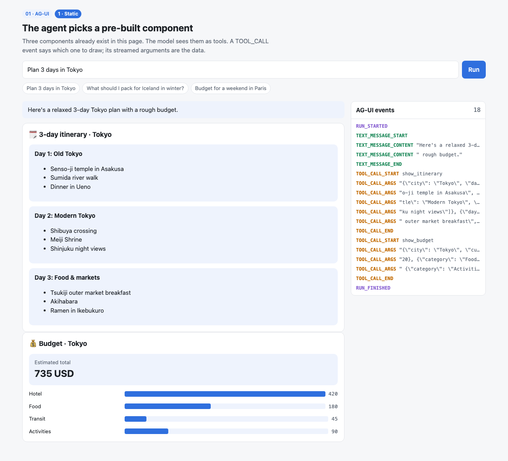
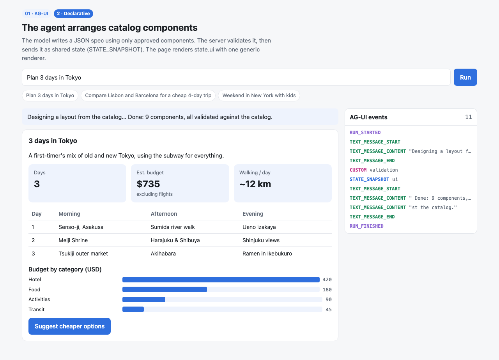
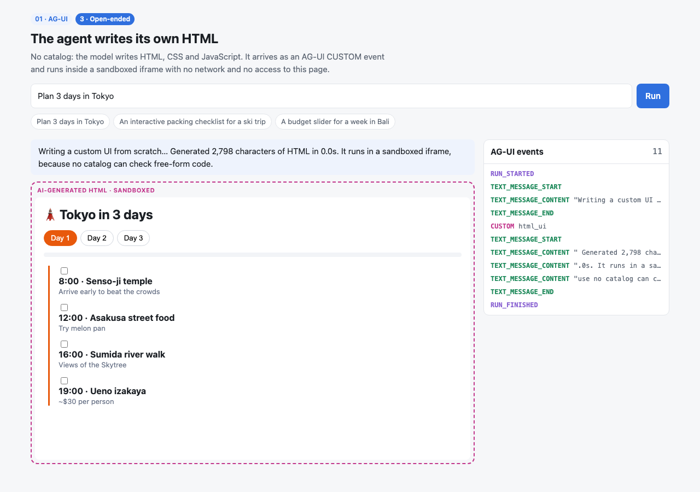
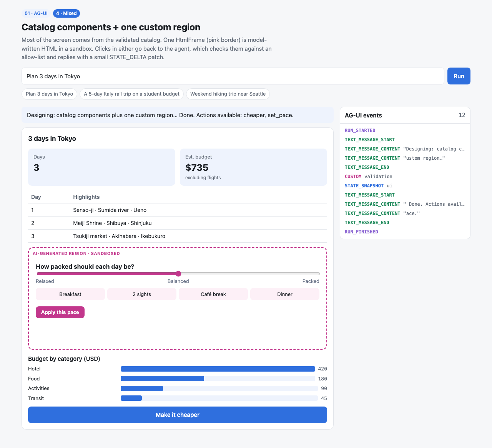
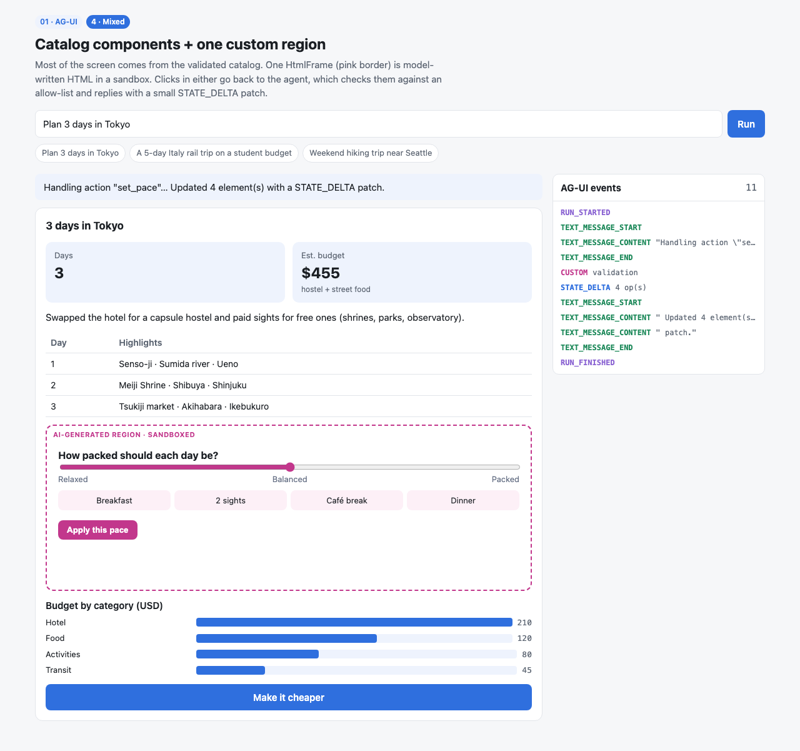

# 01 · AG-UI: the pipe between agent and page

**AG-UI** (Agent–User Interaction protocol) is a standard stream of typed **events** sent from an agent to a web page over Server-Sent Events. It does not define what the UI looks like. It defines how the agent's work reaches the page and how the page talks back.

```
browser ── POST RunAgentInput {threadId, runId, messages, state, forwardedProps} ──▶ server
browser ◀── SSE:  RUN_STARTED · TEXT_MESSAGE_* · TOOL_CALL_* · STATE_* · CUSTOM · RUN_FINISHED ──
```

| Event family | Meaning | Used in |
|---|---|---|
| `RUN_STARTED` / `RUN_FINISHED` / `RUN_ERROR` | One agent turn begins, ends, or fails | all |
| `TEXT_MESSAGE_START/CONTENT/END` | Chat text, streamed in pieces | all |
| `TOOL_CALL_START/ARGS/END` | The agent calls a tool; JSON args arrive in pieces | 1-static |
| `STATE_SNAPSHOT` | The whole shared state (here `{ui: spec}`) | 2-declarative, 4-mixed |
| `STATE_DELTA` | Only the changes, as JSON Patch (RFC 6902) | 4-mixed |
| `CUSTOM` | App-specific data (here: generated HTML, validation results) | 2, 3, 4 |

The Python side uses the official [`ag-ui-protocol`](https://pypi.org/project/ag-ui-protocol/) package, so the events on the wire are the real protocol. The browser side is a 50-line hand-written client ([shared/web/agui-client.js](../shared/web/agui-client.js)), so you can see exactly how SSE parsing works.

## The four demos

All four are the same trip-planner app. Each mode changes one thing.

| Mode | What the model decides | How it travels over AG-UI | New idea |
|---|---|---|---|
| [1-static](1-static/) | **Which** pre-built component + its data | `TOOL_CALL_*` | Components = tools |
| [2-declarative](2-declarative/) | The **layout**, from a catalog | `STATE_SNAPSHOT` | Validate, then render; correction loop |
| [3-open-ended](3-open-ended/) | **Everything** (raw HTML/JS) | `CUSTOM` | Sandboxed iframe; cost of freedom |
| [4-mixed](4-mixed/) | Layout + one custom region | `STATE_SNAPSHOT` → `STATE_DELTA` | Actions, allow-list, patches |

### 1 · Static: the agent picks a pre-built component



- [server.py](1-static/server.py): three `TOOLS`. Each one is a component the page already has. The model calls one or more. `tool_call()` turns each call into `TOOL_CALL_START → ARGS… → END`.
- [app.js](1-static/app.js): `COMPONENTS` holds three hand-written renderers. The page collects `TOOL_CALL_ARGS` pieces by `toolCallId`, parses them at `TOOL_CALL_END`, and draws the matching component.
- Safety: a tool name the page doesn't know is never forwarded.

### 2 · Declarative: the agent arranges catalog components



- [shared/catalog.py](../shared/catalog.py): the catalog lists the allowed components (`Card, Row, Text, Metric, Table, BarChart, Button`). The same list is used for the **prompt** (`catalog_prompt`), the **validator** (`validate_spec`) and the **renderer** ([shared/web/render.js](../shared/web/render.js)).
- [server.py](2-declarative/server.py): `design_ui()` asks for JSON, validates it, and if invalid sends the errors back to the model for one retry. Each attempt is visible as a `CUSTOM validation` event.
- The valid spec is sent as `STATE_SNAPSHOT {ui: spec}`. The page has no trip-specific code at all.
- The spec is a **flat element map** (`{root, elements: {id: {type, props, children}}}`), which makes patching easy later.

### 3 · Open-ended: the agent writes its own HTML



- [server.py](3-open-ended/server.py): streams HTML from the model and sends it in one `CUSTOM html_ui` event, then reports its size and generation time.
- [shared/web/sandbox.js](../shared/web/sandbox.js): there are three layers of protection. (1) `sandbox="allow-scripts"` without `allow-same-origin`, so the HTML can't read the page, cookies or storage. (2) A CSP of `default-src 'none'`, so it has no network access. (3) The only way out is `sendAction(name)`, and the parent accepts only allow-listed names.
- Trade-off: the most freedom, but no validation, more tokens, slower, and an inconsistent look.

### 4 · Mixed: catalog plus one custom region, with actions

| After first run | After clicking *Apply this pace* inside the sandbox |
|---|---|
|  |  |

- The catalog now also allows `HtmlFrame`. The server rejects specs with more than one.
- Clicking a catalog Button **or** calling `sendAction()` in the sandbox starts a new run with `forwardedProps.action`.
- [server.py](4-mixed/server.py) keeps its **own** copy of the last spec per thread, and only accepts actions that spec offered (`actions_in`). Anything else gets `CUSTOM action_blocked`.
- The updated spec is diffed against the old one ([shared/patch.py](../shared/patch.py)). Only the changed elements travel, as `STATE_DELTA`. The page applies them with [shared/web/patch.js](../shared/web/patch.js).

## Run it

```bash
source .venv/bin/activate
python 01-ag-ui/1-static/server.py        # then open http://localhost:8000
python 01-ag-ui/2-declarative/server.py
python 01-ag-ui/3-open-ended/server.py
python 01-ag-ui/4-mixed/server.py
pytest 01-ag-ui                           # 13 offline tests, no API key needed
```

Without a `GEMINI_API_KEY` in `.env`, every demo runs **offline** and replays its saved `offline_reply.*` file, so it costs nothing. Add the key to see real model output.

## Check your understanding

1. In static mode, why is a tool call enough to draw a UI? *(The page already has the component; the call only picks it and supplies props.)*
2. Valid JSON from the model: why is that not enough? *(It must also use only catalog components, the right prop types, and existing child ids.)*
3. Why does the server keep its own copy of the spec instead of trusting `state` from the browser? *(The browser can send anything. The allow-list must come from what the server actually offered.)*
4. Why send `STATE_DELTA` instead of a new snapshot after a click? *(Only what changed travels: 4 ops instead of the whole screen. Our renderer still redraws everything for simplicity, but a smarter one could update just the patched elements.)*
