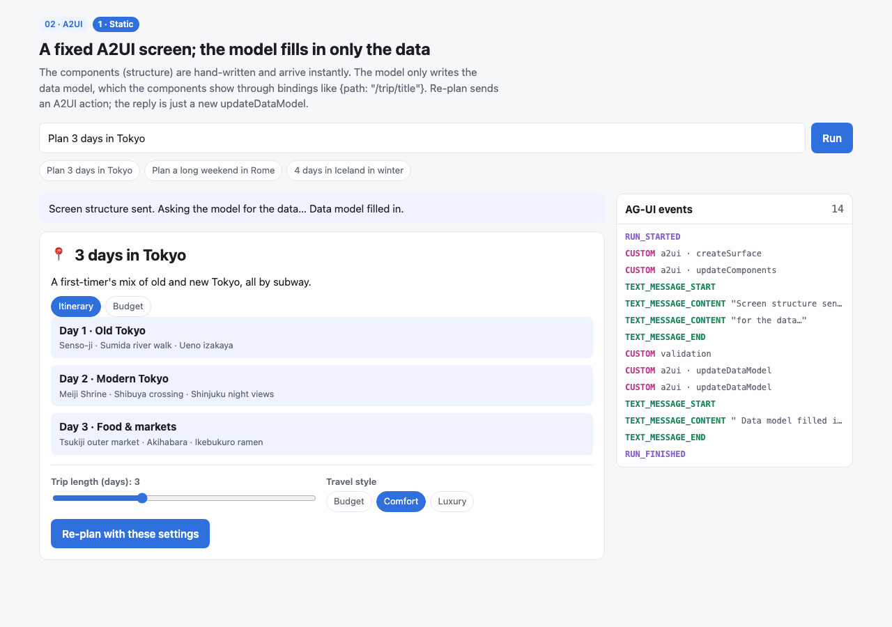
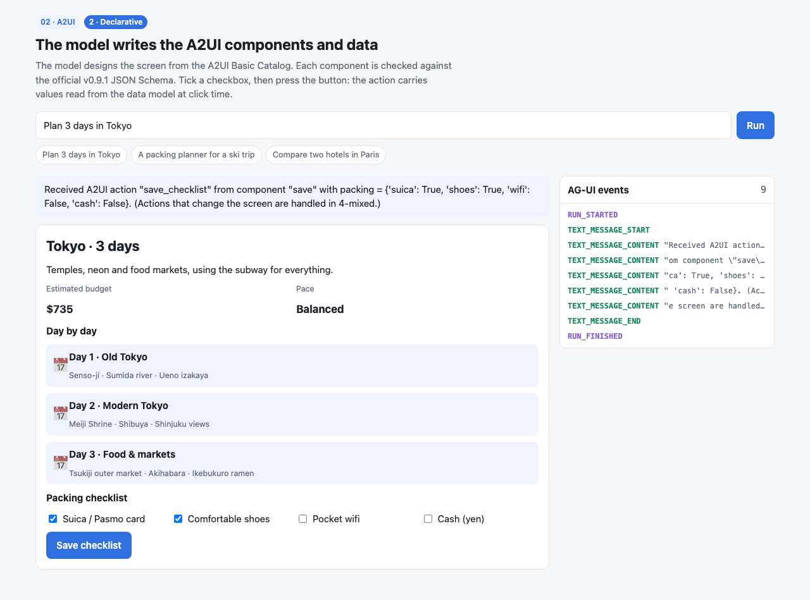
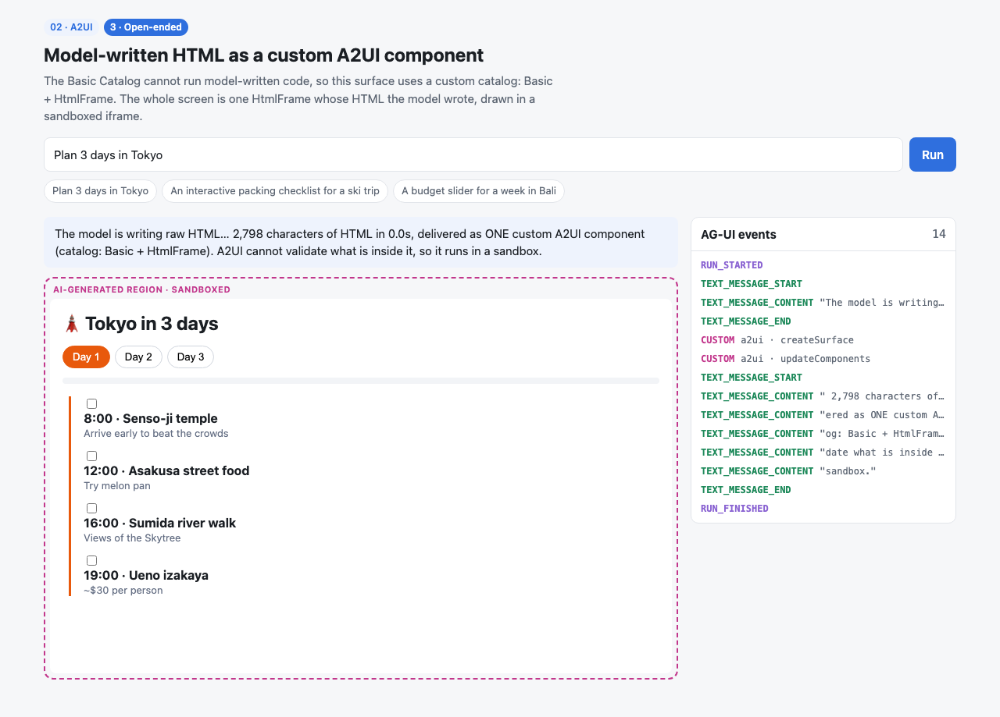
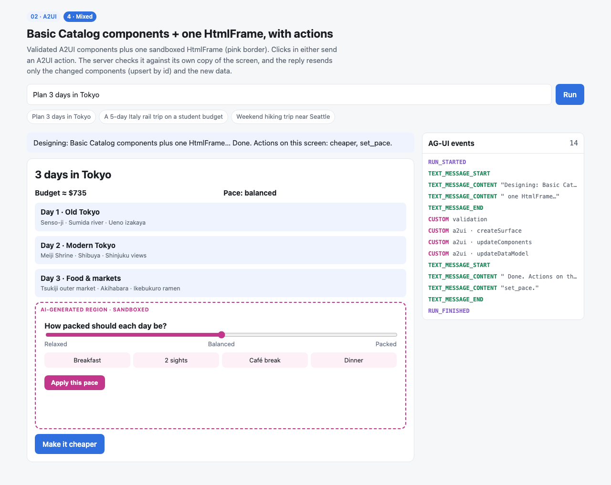
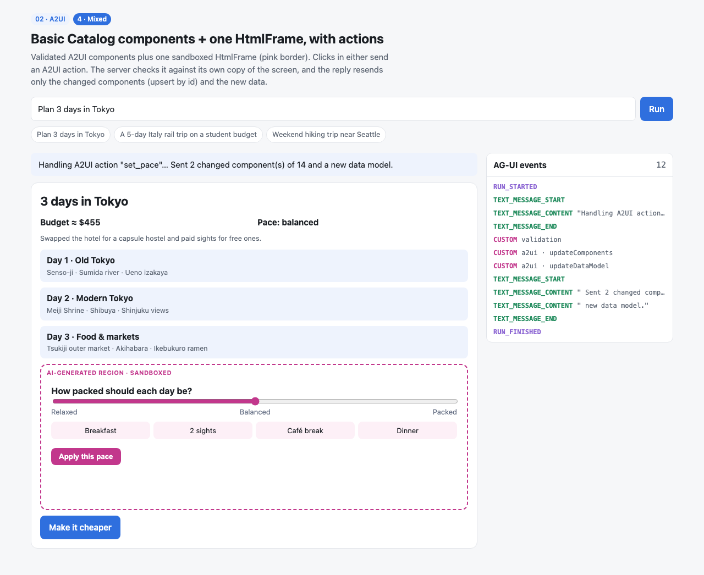

# 02 · A2UI: structure and data as two separate streams

**A2UI** (Agent-to-UI, an open protocol from Google) describes a UI as a stream of JSON **messages**. Its key idea: a screen has a **structure** (components) and **data** (a JSON data model), and they travel separately.

| Message | Carries | Example |
|---|---|---|
| `createSurface` | A new screen + which **catalog** it uses | `{"surfaceId": "trip", "catalogId": "…/basic/catalog.json"}` |
| `updateComponents` | **Structure**: a flat list, joined by ids, upserted by id | `{"id": "title", "component": "Text", "text": {"path": "/trip/title"}}` |
| `updateDataModel` | **Data** at a JSON Pointer path | `{"path": "/trip", "value": {"title": "3 days in Tokyo"}}` |
| `deleteSurface` | Remove a screen | |

Components show data through **bindings** (`{"path": "/trip/title"}`). A `List` can repeat a **template** for every item in a data list, using relative paths (`{"path": "name"}`). Inputs (`Slider`, `CheckBox`, …) write back into the data model. A `Button` sends an **action** message whose `context` is read from the data model at click time:

```json
{"name": "replan", "surfaceId": "trip", "sourceComponentId": "replan", "timestamp": "…", "context": {"days": 5, "style": ["budget"]}}
```

**A2UI is a format, not a transport.** Here every A2UI message rides inside an AG-UI `CUSTOM` event named `a2ui`, through the same pipe as Part 01. Actions go back in AG-UI `forwardedProps.a2uiAction`.

## What's in this folder

| File | Role |
|---|---|
| [a2ui_messages.py](a2ui_messages.py) | Builds the four messages. Validates them against the **official v0.9.1 JSON Schema** in [schema/](schema/), plus tree checks, the action allow-list, and the catalog text for prompts |
| [web/a2ui.js](web/a2ui.js) | A small A2UI client: surface store, JSON Pointer, bindings, templates, two-way inputs, actions, and our custom `HtmlFrame` |
| [web/demo.js](web/demo.js) | The page. **It is identical for all four modes**: an A2UI renderer doesn't care who wrote the messages. Only `server.py` changes |

## The four demos

| Mode | Who writes the structure | Who writes the data | After a click |
|---|---|---|---|
| [1-static](1-static/) | Developer ([surface.json](1-static/surface.json)) | Model | `updateDataModel` only |
| [2-declarative](2-declarative/) | Model (Basic Catalog, schema-checked) | Model | Echo of bound values (no model call) |
| [3-open-ended](3-open-ended/) | Model writes raw HTML in one custom `HtmlFrame` | — | — |
| [4-mixed](4-mixed/) | Model: Basic components + one `HtmlFrame` | Model | Changed components + new data |

### 1 · Static: fixed structure, model-written data



- [surface.json](1-static/surface.json) is written by hand. It uses `Tabs`, two `List` templates (days, budget lines), a `Slider` and a `ChoicePicker` bound to `/form`, and a "Re-plan" `Button` whose context reads `/form/days` and `/form/style`.
- [server.py](1-static/server.py) sends `createSurface` + `updateComponents` **before calling the model**, so the empty skeleton appears instantly. The model then writes only data matching `DATA_SCHEMA`, checked with `jsonschema`.
- Re-plan sends an A2UI action. The reply is **just one `updateDataModel`**; the structure is never resent.

### 2 · Declarative: the model writes A2UI



- The prompt lists the Basic Catalog (`CATALOG_PROMPT`). The model returns `{"components": [...], "data": {...}}`.
- `check()` validates every component against **the official schema** (e.g. *"Card needs `child`, not `children`"*) and checks the tree (a `root` exists, no missing ids). Errors feed the shared correction loop ([shared/correct.py](../shared/correct.py)).
- Tick checkboxes, then press *Save checklist*. The action's `context` carries the live values from the data model.

### 3 · Open-ended: a custom catalog component



- A2UI's Basic Catalog has **no way to run model-written code**, by design. Its extension point is a **custom catalog**: `createSurface` names `TRIP_CATALOG_ID` (Basic + `HtmlFrame`), and the client must implement that component.
- The model writes HTML, and the server wraps it as `{"id": "root", "component": "HtmlFrame", "html": …}`. The official schema rejects `HtmlFrame` unless the custom catalog allows it (`allow_html=True`).

### 4 · Mixed: Basic components + one HtmlFrame, with actions

| First screen | After *Apply this pace* inside the sandbox |
|---|---|
|  |  |

- The model must use **exactly one** `HtmlFrame`. Its `actions` list names what `sendAction()` may send.
- [server.py](4-mixed/server.py) keeps its own copy of the components and checks every action against it (`actions_in`). Unknown names get `CUSTOM action_blocked`.
- The model answers an action with **only the new or changed components** plus the new data. Because `updateComponents` **upserts by id**, A2UI needs no separate patch format. Compare with AG-UI's `STATE_DELTA` in Part 01.

## Run it

```bash
source .venv/bin/activate
python 02-a2ui/1-static/server.py         # then open http://localhost:8000 (same for 2, 3, 4)
pytest 02-a2ui                            # 16 offline tests
```

## Notes and limits

- The renderer is hand-written to keep it readable. It implements the Basic Catalog components our prompts use, but **not** A2UI's client-side functions (`formatCurrency`, `required`, …). In production you would use an official renderer such as `@a2ui/lit`.
- The page re-renders the whole surface on every data change. That resets the active tab and re-creates the sandbox; it's fine for a demo.
- The schemas in [schema/](schema/) are the official A2UI v0.9.1 files (Apache-2.0); see [schema/NOTICE.md](schema/NOTICE.md).

## Check your understanding

1. In static mode, why can the skeleton appear before the model answers? *(The structure doesn't depend on the model; only the data does.)*
2. Valid A2UI JSON from the model: what can still be wrong? *(Missing child ids, no `root`, an action the server never offered.)*
3. How does A2UI update one part of the screen without a patch format? *(`updateComponents` replaces components by id; `updateDataModel` replaces data at a path.)*
4. Why is `HtmlFrame` a *custom catalog* component instead of something A2UI ships? *(A2UI's safety model is "the client only renders components it already trusts". Arbitrary code has to be an explicit, opt-in extension.)*
