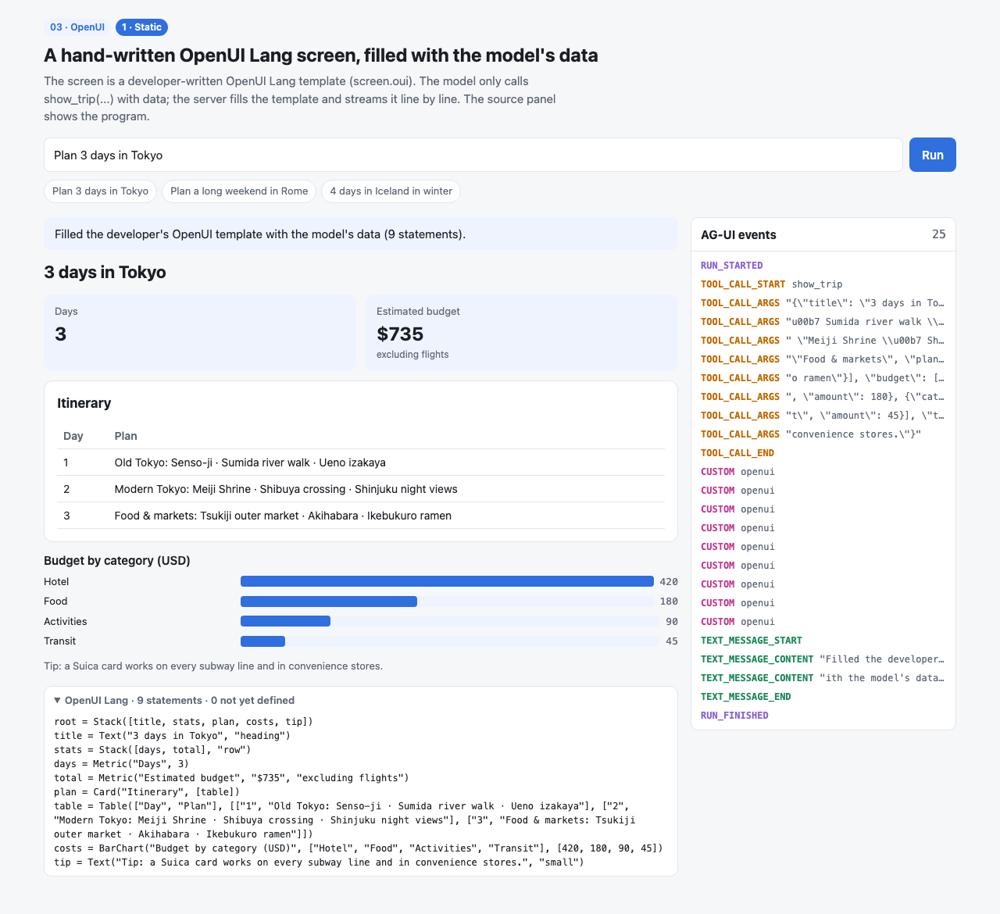
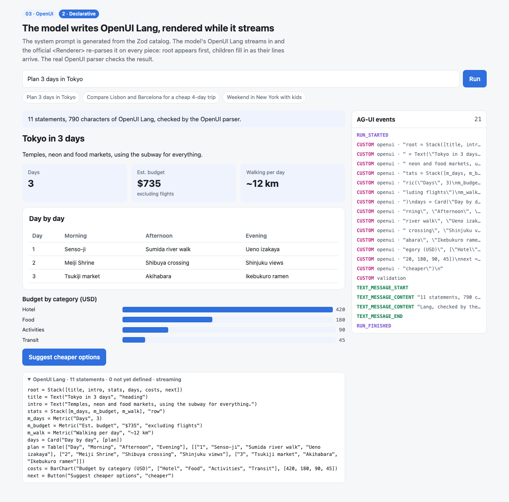
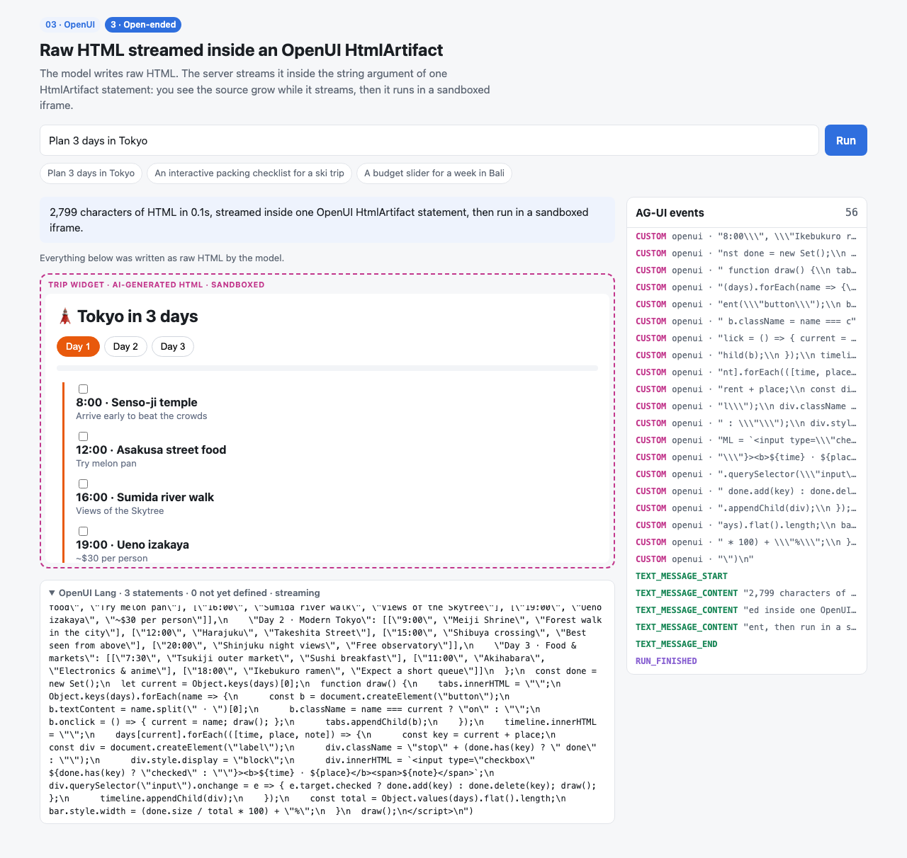
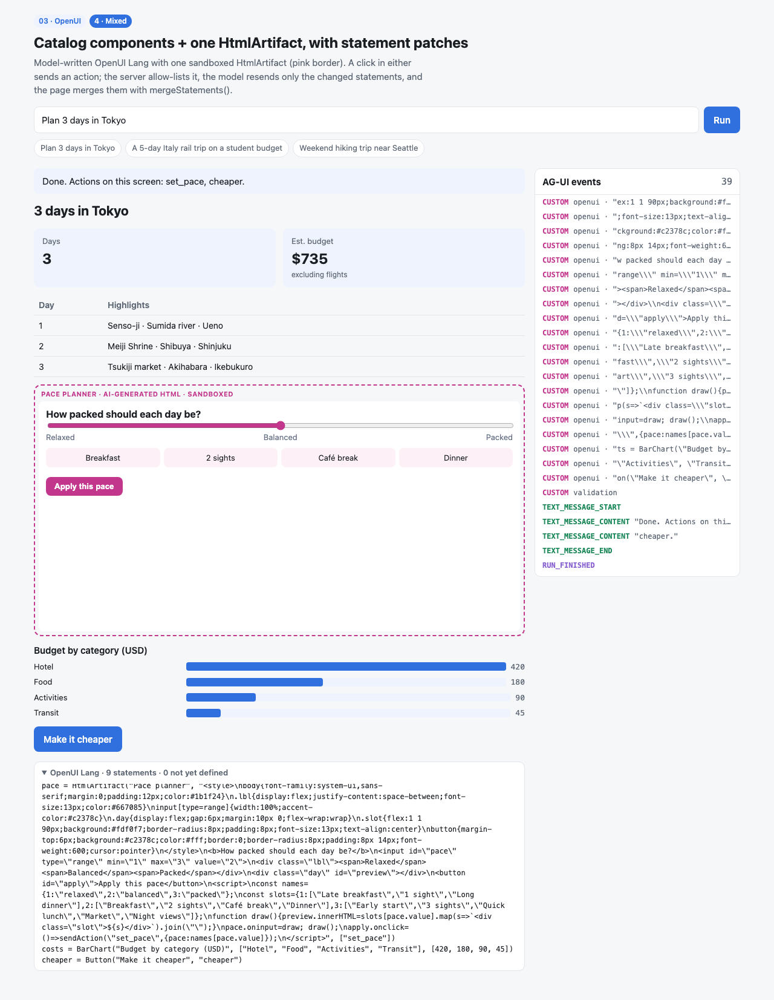
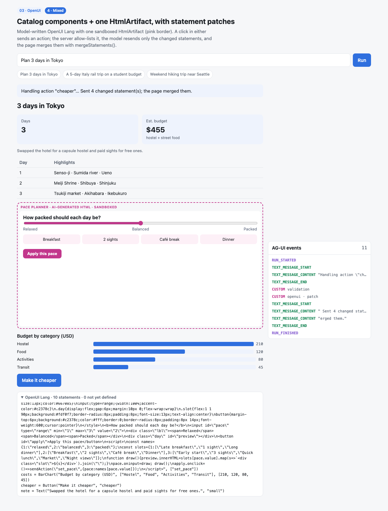

# 03 · OpenUI: a compact UI language that renders while it streams

**OpenUI Lang** (from the OpenUI project, packages `@openuidev/react-lang` and `@openuidev/lang-core`) is a line-based language for model-generated UI:

```
root = Stack([title, stats, plan])          ← the screen's shape comes first
title = Text("3 days in Tokyo", "heading")
stats = Stack([m1, m2], "row")
m1 = Metric("Days", 3)
m2 = Metric("Est. budget", "$735")
plan = Table(["Day", "Plan"], [["1", "Senso-ji"], ["2", "Shibuya"]])
```

- One statement per line: `name = Component(arg1, arg2, …)`. Arguments are **positional**, which keeps it much shorter than JSON.
- References can point **forward**. `root` names `title` before `title` exists. While streaming, the renderer draws `root` first and each child appears when its line arrives.
- `<Renderer>` re-parses the **whole** text after every chunk, so a half-written program is always drawable.

### One definition, three jobs

[web/library.mjs](web/library.mjs) defines each component once with `defineComponent({name, description, props: zod, component})`. The real OpenUI library then uses that single definition for:

| Job | How | Where |
|---|---|---|
| **Prompt** | `library.prompt()` writes the component signatures and syntax rules | [web/prompt.mjs](web/prompt.mjs) → [prompt.txt](web/prompt.txt) |
| **Validation** | `createParser(library.toJSONSchema()).parse(program)` | [web/check.mjs](web/check.mjs), called from Python by [openui_tools.py](openui_tools.py) |
| **Rendering** | `<Renderer response={program} library={library}>` | [web/app.mjs](web/app.mjs) |

The Python servers never re-implement OpenUI. They ask Node to parse with the **same** library the page renders with. The program reaches the page in AG-UI `CUSTOM "openui"` events: `{delta}` to append, `{reset}` to start over, `{patch}` to merge changed statements.

## The four demos

| Mode | Who writes the OpenUI Lang | Streaming | After a click |
|---|---|---|---|
| [1-static](1-static/) | Developer ([screen.oui](1-static/screen.oui)); the model only calls `show_trip(data)` | Line by line | — |
| [2-declarative](2-declarative/) | Model, from the generated prompt | Live, as the model writes | — |
| [3-open-ended](3-open-ended/) | Model writes raw HTML inside one `HtmlArtifact` | HTML source grows, then runs | — |
| [4-mixed](4-mixed/) | Model: catalog + one `HtmlArtifact` | Live | Only the changed statements, merged with `mergeStatements()` |

### 1 · Static: a developer-written OpenUI screen



- [screen.oui](1-static/screen.oui) is OpenUI Lang with `{{placeholders}}`.
- The model calls one tool, `show_trip(title, days, budget, tip)`. `fill()` in [server.py](1-static/server.py) inserts the values with `json.dumps` (which produces valid OpenUI literals and escapes quotes), and the program is streamed line by line.
- The model decides **what** to show; the developer decided **how** it looks.

### 2 · Declarative: the model writes OpenUI Lang



- The system prompt is [prompt.txt](web/prompt.txt), generated from the Zod catalog. Read it: it's the exact contract the model gets.
- `openui.stream_program()` streams the model's text to the page as it arrives. `FenceFilter` drops ```` ``` ```` lines on the fly.
- When the stream ends, the **real OpenUI parser** checks it: unknown components, references that were never defined, wrong argument types. If it fails, the page gets `{reset}` and the model gets the errors.

### 3 · Open-ended: raw HTML inside an HtmlArtifact



- The server opens the statement `widget = HtmlArtifact("Trip widget", "`, streams the model's HTML **into the string** (each piece JSON-escaped), then closes it with `")`.
- While `useIsStreaming()` is true, the component shows the raw source. When the stream ends, it runs the document in the shared sandbox ([shared/web/sandbox.js](../shared/web/sandbox.js)).

### 4 · Mixed: catalog + one HtmlArtifact, with statement patches

| First screen | After *Make it cheaper* |
|---|---|
|  |  |

- The prompt is [prompt_html.txt](web/prompt_html.txt): the catalog plus `HtmlArtifact(title, document, actions?)`. The server requires exactly one `HtmlArtifact` and at least one `Button`.
- Buttons fire OpenUI actions (`useTriggerAction` → `<Renderer onAction>`). The HtmlArtifact's `sendAction()` takes the same path.
- The server checks the action against **its own** copy of the program, then asks the model for **only the changed statements**. `mergeStatements()` replaces statements by name, on the server (to validate) and on the page (to render). Here: 4 statements instead of 10.

## Run it

```bash
source .venv/bin/activate
python 03-openui/2-declarative/server.py     # then open http://localhost:8000
pytest 03-openui                             # 12 offline tests (needs Node, for the parser)
```

To watch offline streaming slowly (useful for demos): `OFFLINE_STREAM_DELAY=0.05 python 03-openui/2-declarative/server.py`.

**Rebuilding the JavaScript** (only if you change `web/*.mjs`): `cd 03-openui/web && npm install && npm run build`. The built files in `web/dist/` and `web/prompt*.txt` are committed, so the demos run without npm.

## Check your understanding

1. Why can OpenUI draw a useful screen before the model has finished? *(`root` and the layout come first; each child appears as its line arrives, and undefined references simply render as nothing for now.)*
2. Why does the server call Node instead of parsing OpenUI Lang in Python? *(It validates with the exact same library and parser the page uses, so "valid on the server" means "renders on the page".)*
3. How do OpenUI updates compare with A2UI and AG-UI? *(OpenUI resends changed statements by name; A2UI upserts components by id; AG-UI sends JSON Patch on shared state.)*
