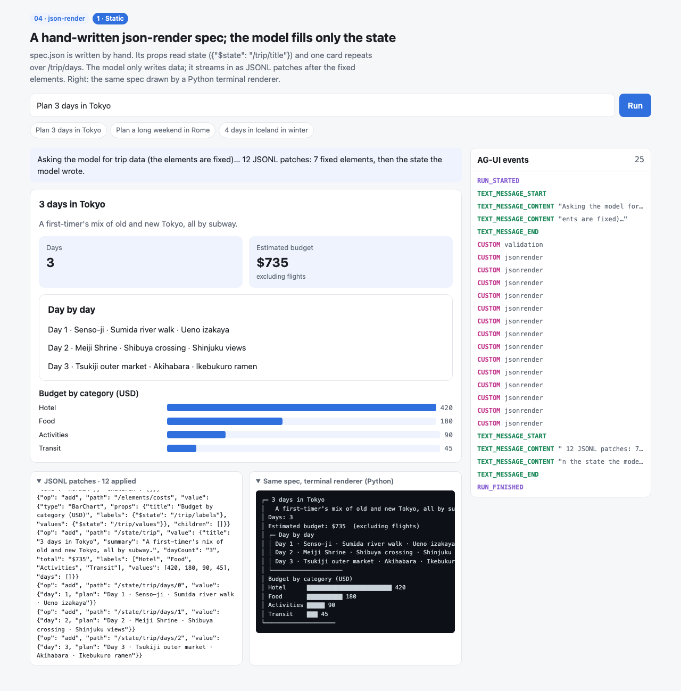
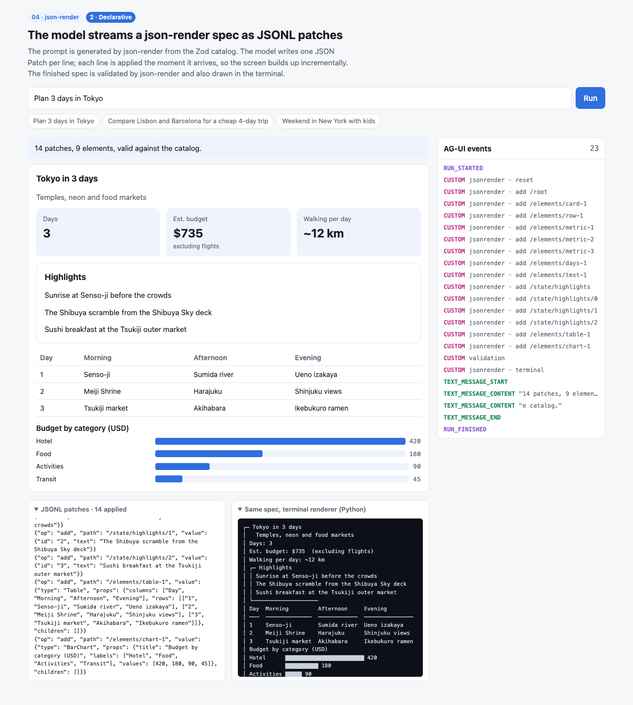
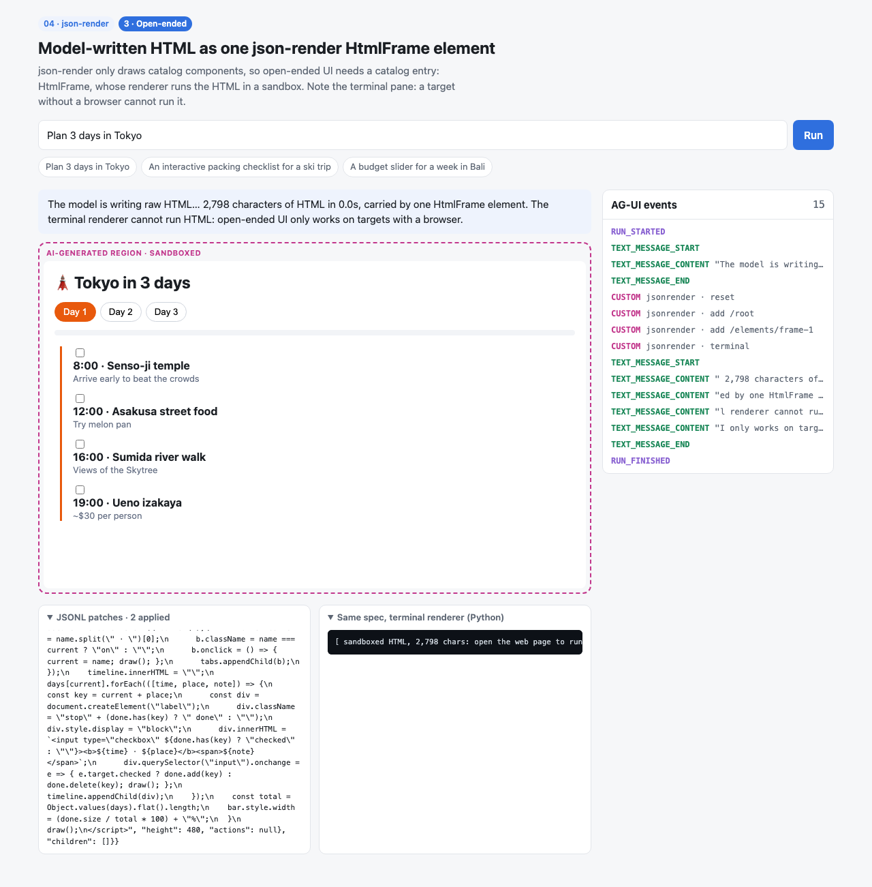
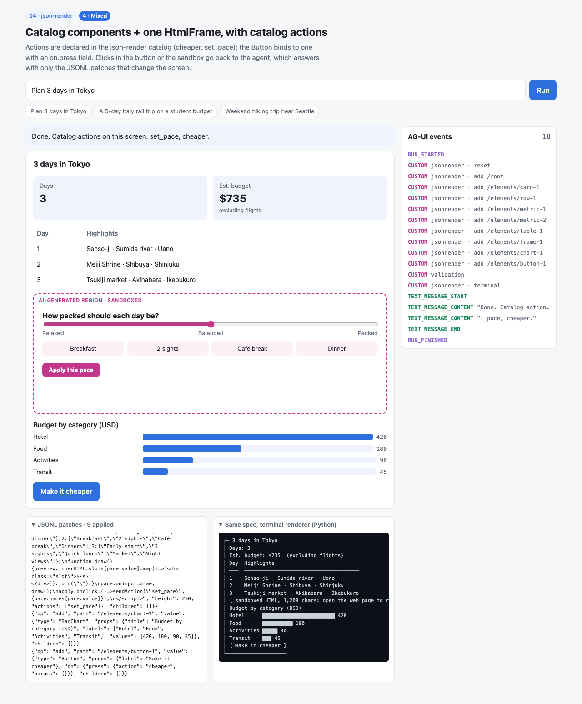
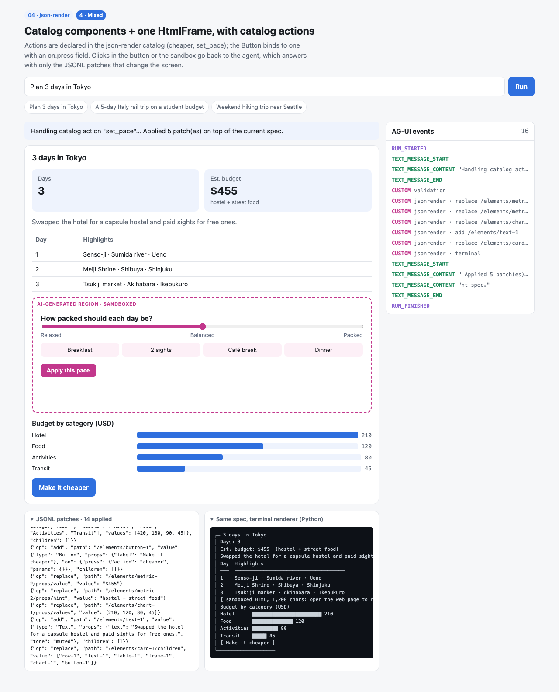

# 04 · json-render: one catalog, a streamed spec, several renderers

**json-render** (Vercel Labs; packages `@json-render/core` and `@json-render/react`) describes a UI as a **spec**:

```json
{ "root": "card-1",
  "elements": { "card-1": { "type": "Card", "props": { "title": {"$state": "/trip/title"} }, "children": ["days-1"] },
                "days-1": { "type": "Card", "props": {"title": "Day by day"}, "repeat": {"statePath": "/trip/days"}, "children": ["text-1"] },
                "text-1": { "type": "Text", "props": { "text": {"$item": "plan"} }, "children": [] } },
  "state": { "trip": { "title": "3 days in Tokyo", "days": [{"plan": "Senso-ji"}, {"plan": "Shibuya"}] } } }
```

The model doesn't write that object in one go. It **streams JSONL**: one RFC 6902 JSON Patch per line, root first, then elements, then state.

```
{"op":"add","path":"/root","value":"card-1"}
{"op":"add","path":"/elements/card-1","value":{...}}
{"op":"add","path":"/state/trip/days/0","value":{"plan":"Senso-ji"}}
```

| Idea | What it gives you |
|---|---|
| **Catalog** ([web/catalog.mjs](web/catalog.mjs)): components *and actions*, with Zod | `catalog.prompt()` (system prompt incl. the JSONL format), `catalog.validate()` |
| **Registry** ([web/registry.mjs](web/registry.mjs)): one React component per entry | `<Renderer spec registry>` draws the spec |
| **State model** | Props read `{"$state": "/path"}`; `repeat` + `{"$item": "field"}` renders lists from state |
| **Stream compiler** | `createSpecStreamCompiler().push(line)` applies each patch; the page redraws after every line |
| **Actions in the catalog** | `"on": {"press": {"action": "cheaper"}}`; undeclared actions are rejected |
| **Several targets** | The same spec renders in React **and** in a terminal ([jr_tools.py](jr_tools.py) `render_terminal`) |

Patch lines reach the page in AG-UI `CUSTOM "jsonrender"` events (`{line}`, `{reset}`, `{terminal}`). The Python server validates with json-render itself via Node ([web/check.mjs](web/check.mjs)), the same approach as Part 03.

## The four demos

| Mode | Who writes the spec | What streams | After a click |
|---|---|---|---|
| [1-static](1-static/) | Developer ([spec.json](1-static/spec.json), with `$state` + `repeat`); the model writes only the **state** | Fixed elements, then state, one day at a time | — |
| [2-declarative](2-declarative/) | Model, as JSONL patches | Each line the moment the model finishes it | — |
| [3-open-ended](3-open-ended/) | Model writes raw HTML in one `HtmlFrame` element | 2 patches | — |
| [4-mixed](4-mixed/) | Model: catalog + one `HtmlFrame` + catalog actions | Live | Only the patches that change the spec |

### 1 · Static: a fixed spec, model-written state



- [spec.json](1-static/spec.json) is hand-written. Props read state (`{"$state": "/trip/title"}`), and the "Day by day" card has `repeat` over `/trip/days`.
- The model returns only trip data (checked with `jsonschema`). `to_patches()` streams the fixed elements first, then `/state/trip`, then `/state/trip/days/0`, `/1`, `/2`, so the days appear one by one.
- Right-hand pane: the **same spec** drawn by the Python terminal renderer.

### 2 · Declarative: the model streams JSONL patches



- The prompt is [prompt.txt](web/prompt.txt), generated by `catalog.prompt()`, including json-render's own rules for JSONL, `$state` and `repeat`.
- `jr.stream_patches()` forwards each complete line immediately and drops fences or prose.
- At the end, `check.mjs` compiles the lines (`compileSpecStream`) and validates with `catalog.validate()` (Zod) and `validateSpec()` (missing children and similar). Errors trigger `{reset}` and one retry.

### 3 · Open-ended: an HtmlFrame catalog entry



- json-render only draws catalog components, so open-ended UI needs a catalog entry: `HtmlFrame`, whose renderer uses the shared sandbox.
- The terminal pane shows the limit: a target without a browser can't run HTML.

### 4 · Mixed: catalog + HtmlFrame + catalog actions

| First screen | After *Apply this pace* inside the sandbox |
|---|---|
|  |  |

- Actions are **declared in the catalog** (`cheaper`, `set_pace {pace}`), so the model is told which ones exist, and `check.mjs` rejects any other name, on Buttons and in `HtmlFrame.actions`.
- The page turns every catalog action into a `JSONUIProvider` handler. Sandbox `sendAction()` calls take the same path.
- The server checks the action against its own copy of the spec. The model replies with **only the patches that change it** (here 5 lines). They're compiled onto the server's copy, validated, and forwarded; the page's compiler applies them on top of what it already shows.

## Run it

```bash
source .venv/bin/activate
python 04-json-render/2-declarative/server.py    # then open http://localhost:8000
pytest 04-json-render                            # 12 offline tests (needs Node)
python 04-json-render/jr_tools.py spec.json      # draw any saved spec in the terminal
```

**Rebuilding the JavaScript** (only if you change `web/*.mjs`): `cd 04-json-render/web && npm install && npm run build`. The built `web/dist/` and `web/prompt*.txt` are committed.

## How the four formats compare

| | AG-UI state (01) | A2UI (02) | OpenUI Lang (03) | json-render (04) |
|---|---|---|---|---|
| Unit | Flat element map | Flat component list + data model | One statement per line | Flat element map + state |
| Streaming | Whole snapshot | Message by message | Re-parse text on every chunk | One JSON Patch per line |
| Update after a click | `STATE_DELTA` (JSON Patch) | Upsert components by id | Re-send statements by name | More JSON Patch lines |
| Data binding | — | `{"path": …}` | — | `{"$state": …}`, `repeat`, `$item` |
| Actions declared in the catalog | No | No | No | **Yes** |

## Check your understanding

1. Why does json-render stream patches instead of one JSON object? *(Each line is complete and applicable on its own, so the screen grows line by line; a half-finished JSON object isn't drawable.)*
2. What does putting actions in the catalog buy you? *(The model is told the exact list, and anything else fails validation before it reaches the page.)*
3. Why can't the terminal renderer show the HtmlFrame? *(Open-ended UI is code for a browser; only targets that can sandbox and run HTML can show it.)*
