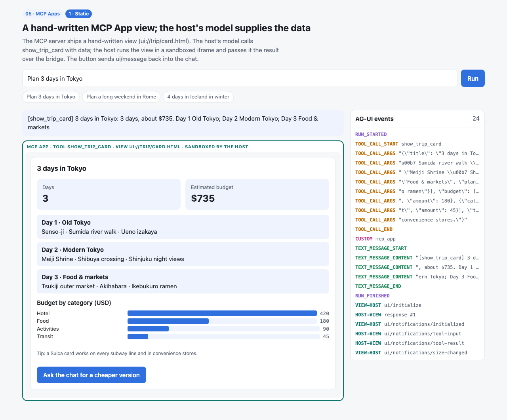
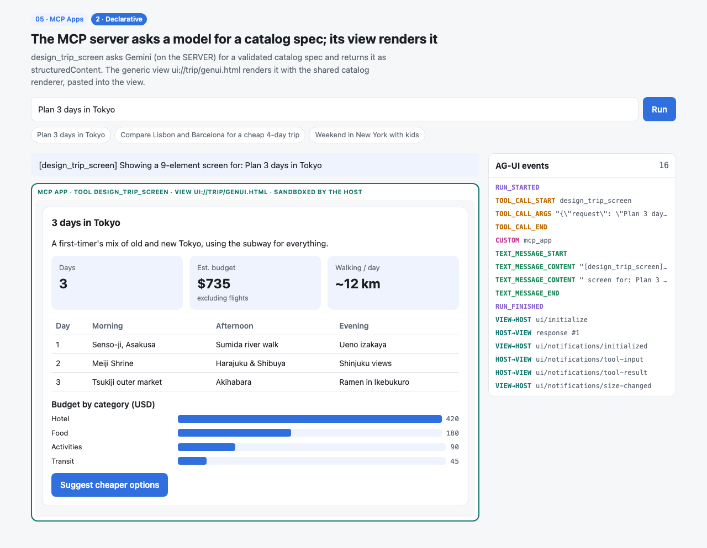
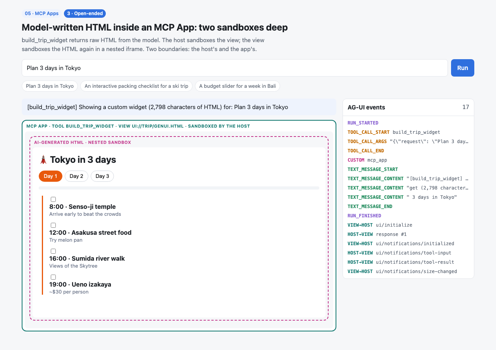
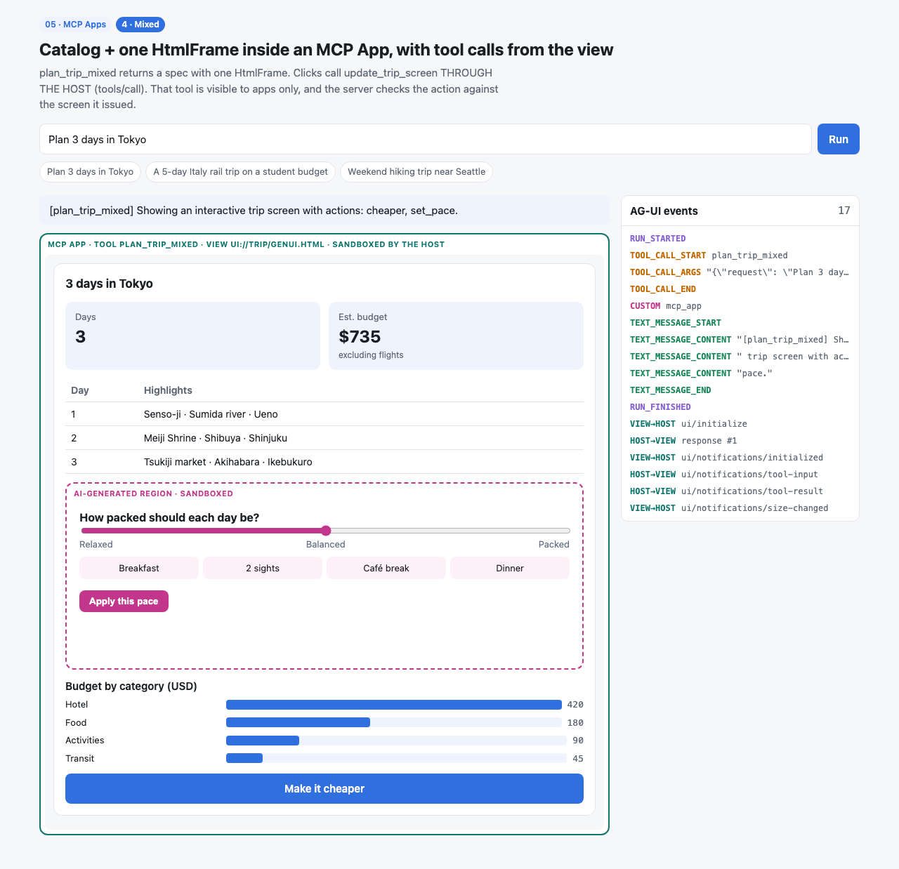
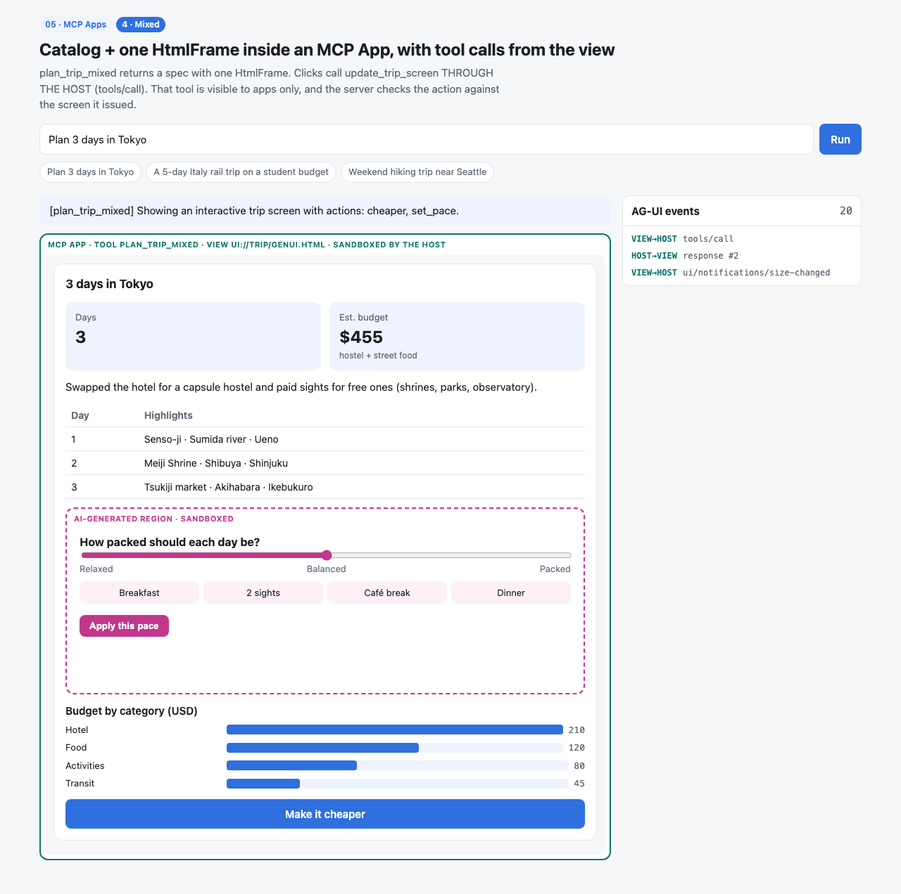

# 05 · MCP Apps: your UI inside someone else's app

In Parts 01–04 we owned the page. **MCP Apps** (the MCP extension SEP-1865, [modelcontextprotocol/ext-apps](https://github.com/modelcontextprotocol/ext-apps)) is for when **another application hosts your UI**: a chat client such as Claude, ChatGPT or Goose. You ship the interface *inside your MCP server*:

1. a **resource** with a `ui://` URI and MIME type `text/html;profile=mcp-app`: the **view**, one self-contained HTML document
2. a **tool** that points at it: `_meta.ui.resourceUri`
3. a **tool result** with `content` (text, for the model) and `structuredContent` (data, for the view)

The **host** reads the view, runs it in a sandboxed iframe with a CSP, and talks to it with **JSON-RPC over `postMessage`**:

```
view → host   ui/initialize                       host → view   (response: host info, capabilities, context)
view → host   ui/notifications/initialized
                                                   host → view   ui/notifications/tool-input   {arguments}
                                                   host → view   ui/notifications/tool-result  {content, structuredContent}
view → host   tools/call   {name, arguments}       (host proxies it to the MCP server, only for app-visible tools)
view → host   ui/message   {text}                  (becomes the next chat turn)
view → host   ui/notifications/size-changed
```

A host that doesn't support MCP Apps ignores `_meta` and shows the text `content`, so the tool still works everywhere.

## What's in this folder

| File | Role |
|---|---|
| [trip_server.py](trip_server.py) | **The MCP server** (Python `mcp` SDK, FastMCP, over stdio): 5 tools, 2 views |
| [views/card.html](views/card.html) | The hand-written view (static mode) |
| [views/genui.html](views/genui.html) | A generic view: catalog spec, sandboxed HTML, or both. `build_view()` pastes in the shared renderer and sandbox, because a view must be a single document |
| [views/view-bridge.js](views/view-bridge.js) | The **view side** of the bridge: `request()`, `notify()`, the lifecycle |
| [mcp_host.py](mcp_host.py) | **Our host**: an MCP client (one long-lived stdio session) + Gemini to pick the tool + `/tool` to relay the view's `tools/call` |
| [web/host.js](web/host.js) | The **host side** of the bridge in the browser: the iframe, the CSP from `_meta.ui.csp`, answering the view |

Every mode folder's `server.py` starts the same host, offering the model only that mode's tool.

## The four demos

| Mode | Tool | Who decides the UI | Boundaries |
|---|---|---|---|
| [1-static](1-static/) | `show_trip_card(title, days, budget, tip)` | Hand-written view; **the host's model** supplies the data as tool arguments | Host iframe |
| [2-declarative](2-declarative/) | `design_trip_screen(request)` | **The server** asks Gemini for a catalog spec and validates it | Host iframe |
| [3-open-ended](3-open-ended/) | `build_trip_widget(request)` | The server asks Gemini for raw HTML | Host iframe → **nested** sandbox |
| [4-mixed](4-mixed/) | `plan_trip_mixed(request)` + `update_trip_screen` (app-only) | Catalog spec + one HtmlFrame; clicks call a tool *through the host* | Both |

### 1 · Static: a hand-written view



- The model (in the host) calls `show_trip_card` with data. The server returns it as `structuredContent`, and [card.html](views/card.html) draws it.
- The event log shows the whole lifecycle: `TOOL_CALL_*` (the host's model), then `VIEW→HOST ui/initialize`, `HOST→VIEW tool-input`, `tool-result`.
- *Ask the chat for a cheaper version* sends `ui/message`, and the host turns it into the next chat turn.

### 2 · Declarative: the server generates a spec



- Two models are involved. The **host's** model only chooses the tool and passes `request`; the **server's** model call designs the screen (`ask_for_spec`, with the shared catalog validator and one retry).

### 3 · Open-ended: two sandboxes deep



- The host sandboxes the view (opaque origin, CSP with no network). The view sandboxes the model's HTML **again** in a nested iframe. A bug or attack in the generated HTML has to get through both boundaries.

### 4 · Mixed: tools called by the view

| First screen | After *Apply this pace* in the nested sandbox |
|---|---|
|  |  |

- `plan_trip_mixed` stores the screen under a `screenId`. A click in the catalog or the nested sandbox makes the view call `tools/call update_trip_screen`, and the host relays it.
- There are three checks:
  1. The host relays only tools that exist and are visible to apps.
  2. `update_trip_screen` has `_meta.ui.visibility: ["app"]`, so the model is never offered it.
  3. The server accepts only actions the screen it issued actually offers (`isError` otherwise).

## Run it

```bash
source .venv/bin/activate
python 05-mcp-apps/4-mixed/server.py     # our host, then open http://localhost:8000
pytest 05-mcp-apps                       # 7 offline tests (each host starts the MCP server over stdio)
```

### In a real MCP host (Claude Desktop, Goose, …)

`trip_server.py` is a normal stdio MCP server, so any MCP host can launch it. In Claude Desktop, add this to `claude_desktop_config.json` (Settings → Developer → Edit Config), using your own path:

```json
{
  "mcpServers": {
    "genui-trip": {
      "command": "/Users/shreram/Desktop/Projects/assignment 4 special topics/.venv/bin/python",
      "args": ["/Users/shreram/Desktop/Projects/assignment 4 special topics/05-mcp-apps/trip_server.py"]
    }
  }
}
```

The server reads the Gemini key from the repo's `.env` itself, and the same $0.20 spending cap applies. Hosts that support MCP Apps show the views; others show the text. *This setup has not been tested in Claude Desktop yet; only our host was tested.*

## Check your understanding

1. Why does the tool result have both `content` and `structuredContent`? *(Text for the model, and for hosts without MCP Apps; data for the view.)*
2. Why must a view be one self-contained document? *(The host's CSP blocks loading other files unless the resource declares their domains in `_meta.ui.csp`.)*
3. Who enforces what a view may do? *(The host decides which bridge requests to honour and which tools to relay; the server still checks every action itself.)*
4. AG-UI vs MCP Apps? *(AG-UI: your agent talks to **your** page. MCP Apps: your server ships UI into **someone else's** host.)*
