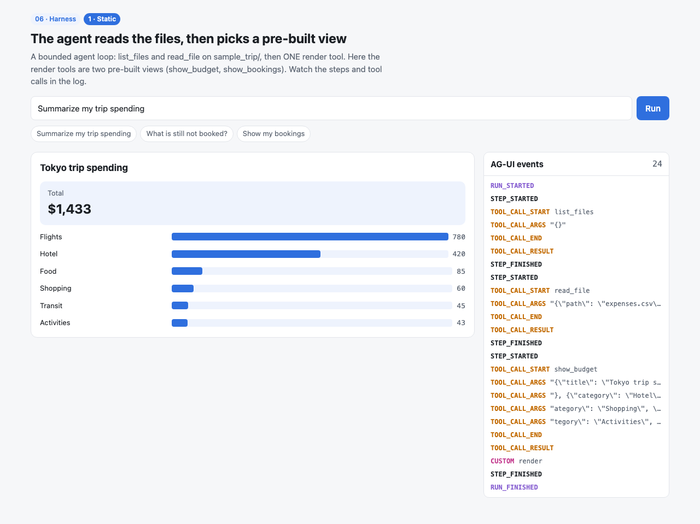
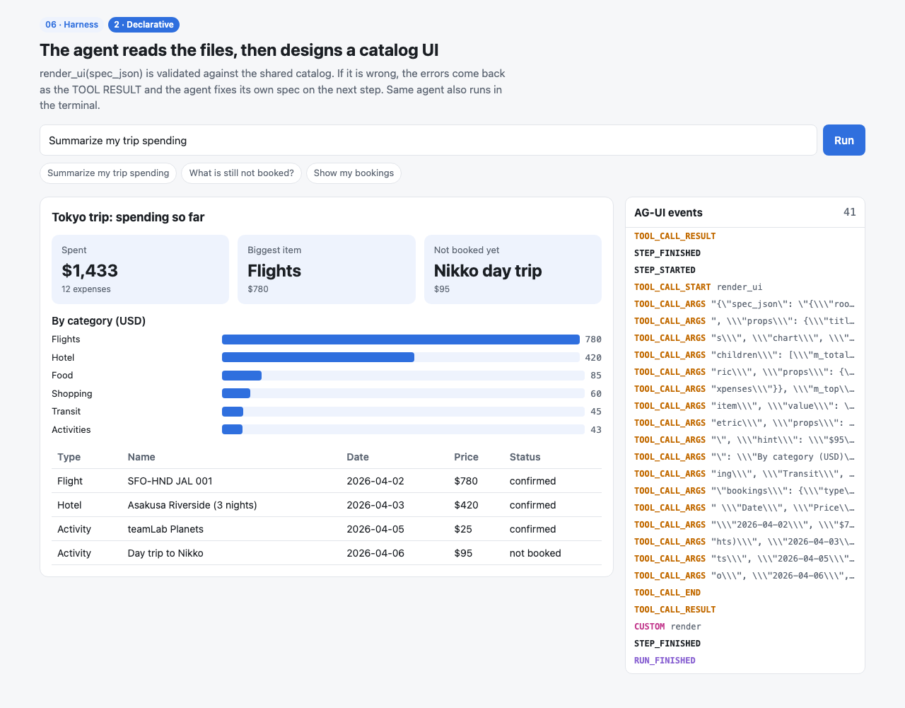
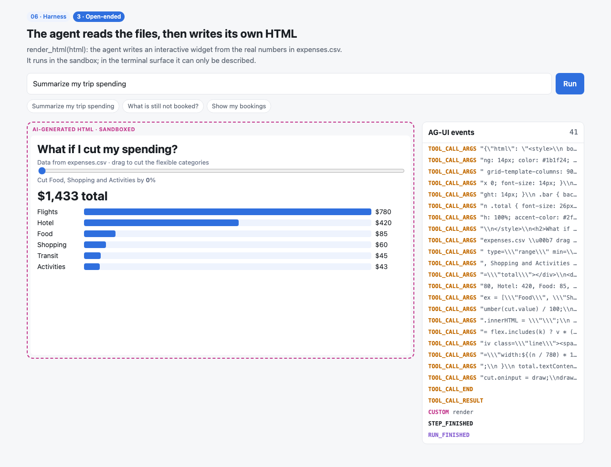
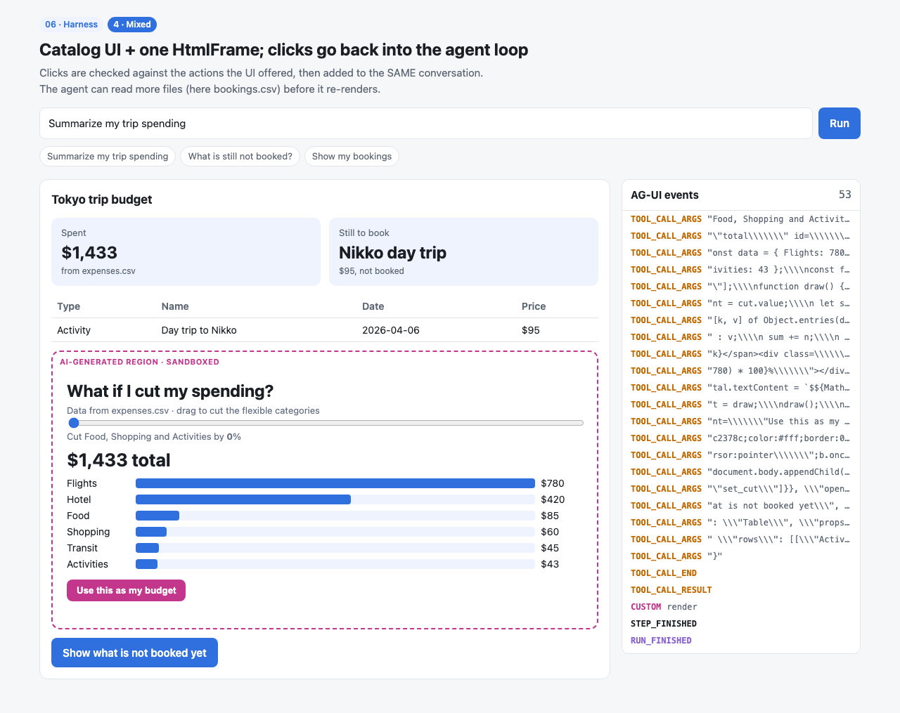

# 06 · Harness integration: generative UI inside an agent loop

Parts 01–05 asked a model for a UI in **one** call. A real coding-agent **harness** is a loop:

```
user request
  └─▶ model ──▶ tool calls (list_files, read_file, …) ──▶ tool results ──▶ model ──▶ … ──▶ render tool ──▶ UI
```

Here the agent works on a small project folder, [sample_trip/](sample_trip/): expenses, bookings, an itinerary and a packing list. It reads the real data and then answers by calling a **render tool**. The render tool is where generative UI joins the loop, and each mode just swaps it:

| Mode | Render tool | What the agent decides |
|---|---|---|
| [1-static](1-static/) | `show_budget(title, items)` / `show_bookings(rows)` | Which pre-built view + its data |
| [2-declarative](2-declarative/) | `render_ui(spec_json)`, shared catalog | The layout |
| [3-open-ended](3-open-ended/) | `render_html(html)` | Everything (sandboxed) |
| [4-mixed](4-mixed/) | `render_ui(spec_json)` incl. one `HtmlFrame` | Layout + one custom region; **clicks return into the same conversation** |

## Key ideas

- **Validation errors are tool results.** If `render_ui` gets an invalid spec, it returns `REJECTED, fix these…` as the tool result. The agent reads it and calls `render_ui` again on its next step. No special correction code is needed; the loop *is* the correction loop.
- **A render ends the turn.** After a successful render the loop stops, saving one model call.
- **One agent, two surfaces.** The same loop streams AG-UI events to the web page (`STEP_STARTED`, `TOOL_CALL_*`, `TOOL_CALL_RESULT`, `CUSTOM render`) and prints to the terminal, where the spec is drawn by [shared/terminal.py](../shared/terminal.py).
- **Actions continue the conversation** (mixed). A click is checked against the actions the current UI offered, then added as a user message to the **same** history. The agent can read more files before it re-renders. In the demo it reads `bookings.csv` to find what isn't booked.

## Safety limits

An agent loop can wander and run up a bill, so the harness is deliberately small:

| Limit | Where |
|---|---|
| File tools only see `sample_trip/` (no `..`, no absolute paths) | `safe_path()` in [harness.py](harness.py) |
| File reads capped at 4 KB | `MAX_READ` |
| At most 6 model calls per turn | `MAX_STEPS` (tested: `test_loop_stops_at_max_steps`) |
| Conversation history trimmed to 24 messages | `trim()` |
| Every model call goes through the **$0.20 spending cap** | [shared/llm.py](../shared/llm.py) |

Gemini 3 attaches "thought signatures" to tool calls and expects them back on the next turn, so the loop sends back the model's **raw** assistant message (`assistant_message` from `llm.chat`) instead of rebuilding it.

## Screenshots

| Static | Declarative |
|---|---|
|  |  |

| Open-ended | Mixed, after *Show what is not booked yet* |
|---|---|
|  |  |

## Run it

```bash
source .venv/bin/activate

# web surface
python 06-harness-integration/2-declarative/server.py          # then open http://localhost:8000

# terminal surface: same agent, same tools
python 06-harness-integration/harness.py --mode declarative "Summarize my trip spending"
python 06-harness-integration/harness.py --mode static "Show my bookings"

pytest 06-harness-integration                                  # 8 offline tests
```

Offline (no key), each mode replays `offline_script.json`: the recorded model replies, one per step.

## Files

| File | Role |
|---|---|
| [harness.py](harness.py) | Tools, the loop (`agent_turn`), limits, and the terminal surface (`main`) |
| [harness_app.py](harness_app.py) | The web surface: AG-UI streaming, per-thread conversations, the action allow-list |
| [web/harness-page.js](web/harness-page.js) | The page: the pre-built views (static), the catalog renderer, the sandbox |
| `*/offline_script.json` | Recorded model replies for offline runs |

## Check your understanding

1. Why is a validation error returned as a tool result instead of raising an exception? *(The agent can read it and fix its own output; the loop already handles retries.)*
2. Why must the file tools be confined to one folder? *(The model chooses the paths. Without a boundary it could read secrets such as `.env`, which a test checks.)*
3. What changes between the web and terminal surfaces? *(Only the last step: how the rendered UI is drawn. The loop, tools and spec are the same.)*
