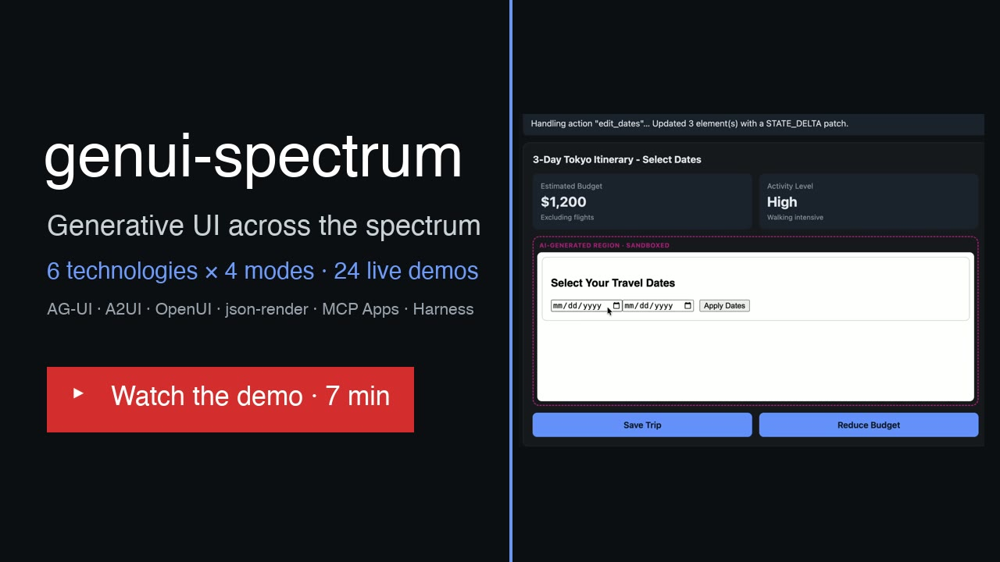
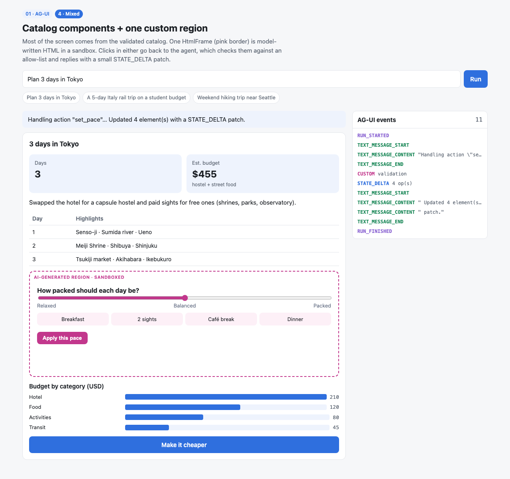
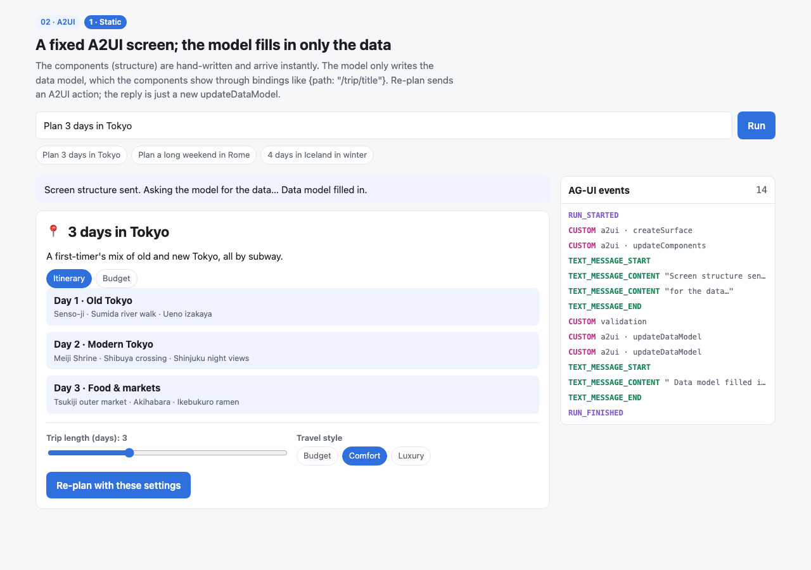
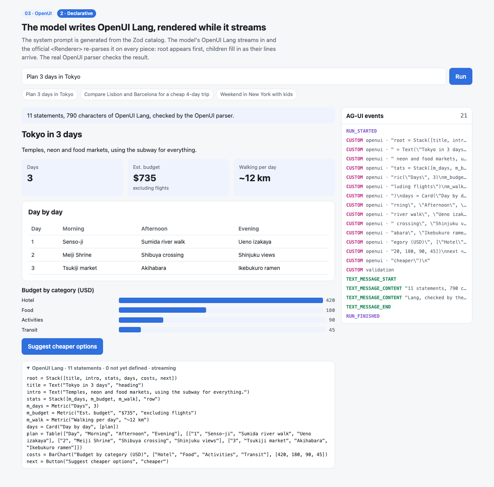
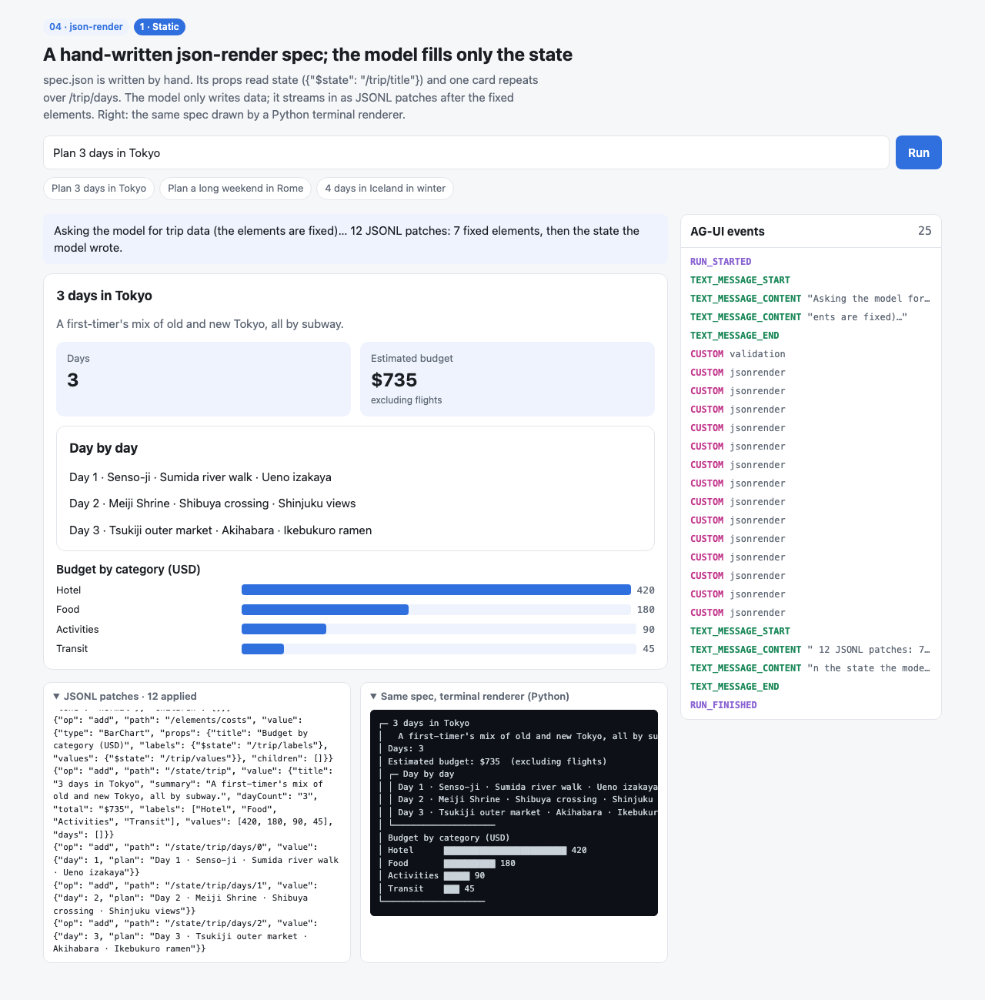
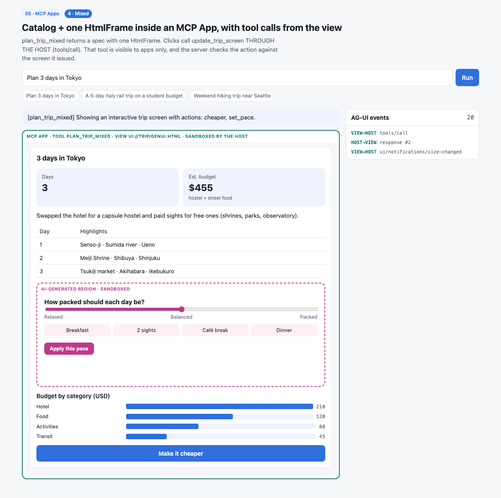
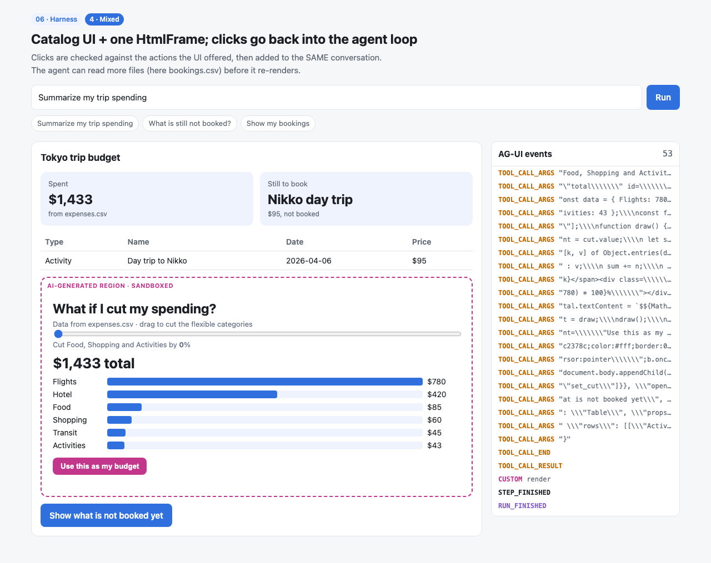

<div align="center">

# genui-spectrum

**Generative UI across the spectrum: what happens when an AI answers with a _screen_ instead of text.**

One trip-planner app · 6 generative-UI technologies · 4 modes each · **24 runnable demos**

<a href="https://youtu.be/3bj3nr9uyGA"></a>

### ▶ [Watch the 7-minute walkthrough on YouTube](https://youtu.be/3bj3nr9uyGA)


</div>

---

## What is this?

Ask an AI *"Plan 3 days in Tokyo"* and you usually get a wall of text. **Generative UI** lets it answer with an interface instead: an itinerary card, a budget chart, a button that says *"Make it cheaper"*.

That raises one question, and this project is built around it:

> **How much of the screen should the AI be allowed to decide?**

To answer it, I built the **same trip-planner app 24 times**: six generative-UI technologies, each in four modes, from fully controlled to fully free. Because the app never changes, the only thing that differs between demos is the technology or the mode.

## The spectrum: four modes

```
   SAFE & CONTROLLED  ◀──────────────────────────────────────────▶  FREE & FLEXIBLE
        Static            Declarative            Mixed              Open-ended
   picks a ready-made   arranges approved    catalog parts +     writes its own
   component, fills     building blocks      one sandboxed        HTML/JS, runs in
   in the data          (validated)          custom region        a sandbox
```

| Mode | What the model decides | Why you'd use it |
|---|---|---|
| **Static** | Which pre-built component to show, and its data | Safest, cheapest, always on-brand |
| **Declarative** | The layout, using only an approved **catalog**; every screen is validated first | Flexible but still safe and consistent |
| **Open-ended** | Everything: it writes raw HTML/CSS/JS, which runs in a sealed **sandbox** | Unusual widgets the catalog can't express |
| **Mixed** | Catalog parts + **one** sandboxed custom region, and clicks go back to the agent | The practical sweet spot |

One rule runs through every demo: **a click is a request, not a permission.** Every action the UI sends back is checked against what the server actually offered.

## The six technologies

| # | Technology | The question it answers | Demos |
|---|---|---|---|
| 01 | **[AG-UI](01-ag-ui/)** | How does an agent's work reach the page, step by step? | [static](01-ag-ui/1-static/) · [declarative](01-ag-ui/2-declarative/) · [open-ended](01-ag-ui/3-open-ended/) · [mixed](01-ag-ui/4-mixed/) |
| 02 | **[A2UI](02-a2ui/)** | Can a screen's structure and its data travel separately? | [static](02-a2ui/1-static/) · [declarative](02-a2ui/2-declarative/) · [open-ended](02-a2ui/3-open-ended/) · [mixed](02-a2ui/4-mixed/) |
| 03 | **[OpenUI](03-openui/)** | Can the screen draw while the model is still writing it? | [static](03-openui/1-static/) · [declarative](03-openui/2-declarative/) · [open-ended](03-openui/3-open-ended/) · [mixed](03-openui/4-mixed/) |
| 04 | **[json-render](04-json-render/)** | Can one screen description work in different places (web *and* terminal)? | [static](04-json-render/1-static/) · [declarative](04-json-render/2-declarative/) · [open-ended](04-json-render/3-open-ended/) · [mixed](04-json-render/4-mixed/) |
| 05 | **[MCP Apps](05-mcp-apps/)** | Can my UI appear inside someone else's app, like a chat client? | [static](05-mcp-apps/1-static/) · [declarative](05-mcp-apps/2-declarative/) · [open-ended](05-mcp-apps/3-open-ended/) · [mixed](05-mcp-apps/4-mixed/) |
| 06 | **[Harness](06-harness-integration/)** | Can an agent read real files first, *then* draw a screen? | [static](06-harness-integration/1-static/) · [declarative](06-harness-integration/2-declarative/) · [open-ended](06-harness-integration/3-open-ended/) · [mixed](06-harness-integration/4-mixed/) |

Each folder has its own README with a step-by-step code walkthrough and screenshots.

<details>
<summary><b>How each technology implements each mode</b></summary>

| | Static | Declarative | Open-ended | Mixed (+ actions) |
|---|---|---|---|---|
| **AG-UI** | Pre-built components = tools (`TOOL_CALL_*`) | Spec in shared state (`STATE_SNAPSHOT`) | HTML in a `CUSTOM` event | Clicks → allow-list → `STATE_DELTA` |
| **A2UI** | Hand-written components; model writes the **data model** | Model writes components, checked by the official v0.9.1 schema | Custom catalog component `HtmlFrame` | Upsert changed components by id + new data |
| **OpenUI** | Hand-written OpenUI Lang template | Model writes OpenUI Lang, rendered **while streaming** | HTML streamed inside an `HtmlArtifact` | Resend changed statements, `mergeStatements()` |
| **json-render** | Hand-written spec; model writes the **state** | Model streams **JSONL patches** | `HtmlFrame` catalog entry | Actions declared **in the catalog**, patch-only updates |
| **MCP Apps** | Hand-written `ui://` view | The server's model designs the spec | **Nested** sandbox inside the view | The view calls an app-only tool through the host |
| **Harness** | Agent picks a pre-built view after reading files | `render_ui` tool; errors come back as tool results | `render_html` tool | Clicks continue the same agent conversation |

</details>

## Screenshots

| AG-UI · mixed: a click returns a `STATE_DELTA` | A2UI · static: structure first, then data |
|---|---|
|  |  |
| **OpenUI · declarative: drawn while streaming** | **json-render · static: same spec on web and terminal** |
|  |  |
| **MCP Apps · mixed: the view calls tools via the host** | **Harness · mixed: the agent reads files, then redraws** |
|  |  |

## Quick start

Requires **Python 3.13** and **Node.js 22+** (Node runs the real OpenUI and json-render parsers).

```bash
git clone https://github.com/shreramsp/genui-spectrum.git
cd genui-spectrum
python3.13 -m venv .venv && source .venv/bin/activate
pip install -r requirements.txt
cp .env.example .env            # optional: add GEMINI_API_KEY for live model calls
```

**No API key?** Everything still runs: each demo replays a saved model reply, so you can explore for free. Get a key at [aistudio.google.com/apikey](https://aistudio.google.com/apikey) to use `gemini-3.1-flash-lite` live.

```bash
python shared/run_all.py                          # all 24 demos + a hub page at http://localhost:8000
python 02-a2ui/4-mixed/server.py                  # or a single demo at http://localhost:8000
python 06-harness-integration/harness.py --mode declarative "Summarize my trip spending"   # the agent, in your terminal
pytest                                            # 70 offline tests
python shared/check_all.py                        # every test + every demo opened in a headless browser
```

Tips: `PORT=8001 python …` runs a second demo side by side · `OFFLINE=1` forces offline mode · `OFFLINE_STREAM_DELAY=0.05` slows offline streaming so you can watch screens build up.

## Safety and cost, by design

| Guardrail | What it does |
|---|---|
| **Catalog + validation** | The model can only use approved components; invalid screens are sent back to be fixed |
| **Sandboxed iframes** | Model-written code runs with no network, no cookies and no access to the page (`sandbox="allow-scripts"` + strict CSP) |
| **Action allow-lists** | Every click is checked against the actions the server actually offered |
| **Bounded agent** | The harness can read one folder only, at most 6 steps, 4 KB per file |
| **Spending cap** | Every Gemini call is refused *before sending* if its worst-case cost could pass `SPEND_LIMIT_USD` (default $0.20) |

Running all six parts live costs well under a cent per demo.

## Project layout

```
shared/                   written once, reused by every demo
  llm.py                  Gemini via the OpenAI-compatible API · offline replay · spending cap
  agui.py                 AG-UI events, SSE streaming, the demo web app
  catalog.py              the shared component catalog: prompt text + validator + action allow-list
  correct.py · patch.py   the correction loop · JSON Patch diff/apply
  terminal.py             a terminal renderer for specs
  web/                    AG-UI client, catalog renderer, sandbox, page shell, styles
  run_all.py · check_all.py
01-ag-ui/ … 06-harness-integration/
  README.md               walkthrough of that technology
  1-static/ 2-declarative/ 3-open-ended/ 4-mixed/
     server.py            the agent (FastAPI) → open http://localhost:8000
     app.js, index.html   the page
     offline_*            saved model replies for offline mode
     test_demo.py         offline tests
```

## Built with

Python · FastAPI · [AG-UI](https://docs.ag-ui.com) (`ag-ui-protocol`) · [A2UI](https://a2ui.org) v0.9.1 · [OpenUI](https://github.com/thesysdev/openui) (`@openuidev/react-lang`) · [json-render](https://github.com/vercel-labs/json-render) · [MCP Apps](https://github.com/modelcontextprotocol/ext-apps) (MCP Python SDK) · React · Zod · esbuild · Gemini · pytest · Playwright

## Acknowledgements

Thanks to the teams behind AG-UI, A2UI, OpenUI, json-render and the Model Context Protocol for open specs and libraries. The A2UI schemas in [02-a2ui/schema](02-a2ui/schema/) are the official Apache-2.0 files. The overall approach was inspired by the generative-UI lessons in [dlmastery/simple-coding-harness](https://github.com/dlmastery/simple-coding-harness/tree/main/genui).
